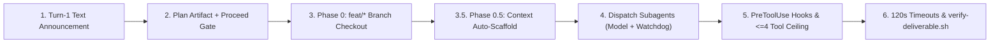

# 🤖 Antigravity Multi-Agent Workflow & Enterprise Governance Kit (v2.1)

> Enterprise Standard Operating Procedures (SOP), Human-in-the-Loop Planning Gates, Native Tool Subagent Architecture, and Pre-Delivery Verification for Google Antigravity.

---

## 📌 Executive Overview

This repository establishes the definitive engineering governance framework between human engineers and autonomous AI agent swarms in Google Antigravity:

1. **Human-in-the-Loop Planning Gate:** Mandates that the AI formulate an explicit Delegation Matrix and halt execution at a "Proceed" barrier before modifying source code or running non-trivial operations.
2. **Phase 0 Git Branch Safety (P0):** Strictly prohibits direct modifications on `main` or `master`. Enforces isolated feature branches (`feat/*`).
3. **Phase 0.5 Base Context Scaffold Auto-Detection:** Automatically inspects target repositories for `.agents/knowledge/project-overview.md` and runs `./scripts/scaffold.sh` to auto-detect tech stack manifests (Node.js, Python, Rust, Go) and bootstrap `.agents/` knowledge specs before specialist discovery begins.
4. **True Multi-Agent Subagent Architecture (Anti-Pretense):** Dispatches genuine, independent subagents (`invoke_subagent`) bound by structured Delegation Contracts with disjoint file scopes. Strictly prohibits monolithic coordinators from faking specialist phase banners.
5. **Native Antigravity Tool Integration (v2.1):** Centralizes all **20 enterprise specialist agents** directly in version control. All agents declare canonical Antigravity native tools (`read_file`, `edit_file`, `write_file`, `run_command`, `manage_task`, `search_web`), completely eliminating legacy Claude Code tool runtime crashes (`tool "Read" not found in registry`).
6. **Mechanical `PreToolUse` Hooks (`hooks.json`):** Enforces both destructive-command blocking (`validate-tool-call.mjs` on `run_command`) and the 4-tool anti-silent circuit breaker (`circuit-breaker.mjs` on `*`) before tool execution.
7. **Strict Anti-Silent Circuit Breaker (≤4 Tools):** Enforces immediate Turn-1 text-first announcements and hard yields: agents must never exceed 4 consecutive tool calls without visible interim progress text.
8. **Execution Resilience, Watchdogs & Model Tiering:** Mandates `120s` macOS-portable command timeouts, `MAX_RETRIES=3`, `schedule` one-shot watchdogs (`DurationSeconds: 600`), interim `send_message` before background waits, Bash 3.2 cleanup traps/`wait "$PID"`, and `Model: "flash"` default tiering (`inherit`/`pro` reserved for architecture, complex debugging, and synthesis).
9. **Mandatory Pre-Delivery Verification (`verify-deliverable.sh`):** Zero-defect delivery standard. Every generated `.docx`, `.xlsx`, `.pdf`, or formatted document must empirically pass structural, ZIP container, and XML schema checks (local `./scripts/verify-deliverable.sh` or `~/.gemini/config/plugins/ag-kit/scripts/verify-deliverable.sh` in external repos) before user delivery.
10. **Scratch File Isolation:** Mandates that all temporary generator scripts, intermediate assets, and diagnostic fixtures reside strictly in `<Artifact Directory Path>/scratch/` or `/tmp/`, preserving clean workspace trees.
11. **Decoupled CI/CD Architecture:** Reusable 2-stage GitHub Actions pipelines (CI Gate with TruffleHog secret scanning and automated testing; CD with health-check rollbacks).
12. **Obsidian-Compliant SOP Playbook:** Complete documentation with native Mermaid diagrams, Obsidian callouts, Execution & Resilience Metrics, and empirical real-world audit case studies.

---

## 📂 Repository Structure

```text
.
├── WORKFLOW-PLAYBOOK.md        # 📘 Enterprise SOP playbook (Obsidian-compliant)
├── README.md                   # 📖 Documentation and onboarding guide
├── Makefile                    # ⚡ Automation targets (install, verify, scaffold)
├── hooks.json                  # 🪝 Antigravity PreToolUse hook registry
├── skills-lock.json            # 🔒 Deterministic skill dependency lockfile
├── hooks/                      # 🛡️ Runtime PreToolUse enforcement hooks
│   ├── circuit-breaker.mjs     # Blocks the 5th consecutive silent tool call (ceiling: 4)
│   └── validate-tool-call.mjs  # Safety gate blocking destructive root-disk shell commands
├── rules/                      # 🏛️ Persistent governance rules (linked to Antigravity)
│   ├── GEMINI.md               # Master rules: 4-tool circuit breaker, timeouts, watchdogs, verification
│   ├── core-protocol.md        # Turn-1 constraints, anti-silent loops, watchdogs, model tiering
│   ├── planning-gate.md        # Phase 0 setup, Proceed gate barrier, Phase 4 resilience metrics
│   ├── git-safety.md           # P0 rule: strict prohibition of direct edits on main
│   ├── delegation-contract.md  # Subagent contracts, disjoint ownership, timeout & watchdog budgets
│   ├── impact-analysis.md      # Full-stack "One Change, Two Sides" synchronization
│   ├── request-routing.md      # Autonomous domain classifier and specialist router checklist (<=4 tools)
│   ├── universal-rules.md      # Clean code, 120s timeouts, MAX_RETRIES=3, Bash 3.2 safety, deliverable QA
│   ├── code-rules.md           # Implementation rules, Socratic gate, script timeouts & Bash safety
│   ├── design-rules.md         # UI/UX engineering constraints (pure ASCII en-US)
│   └── quick-reference.md      # High-speed lookup index for agents and skills
├── agents/                     # 🤖 Complete 20-Agent Enterprise Roster (Native Antigravity Tools)
│   ├── orchestrator.md         # Multi-agent coordinator (mainAgent: true, direct edit prohibited)
│   ├── backend-specialist.md   # APIs, database models, and server logic
│   ├── code-archaeologist.md   # Legacy code refactoring and reverse engineering
│   ├── database-architect.md   # Schema design, indexing, and migration
│   ├── debugger.md             # Systematic debugging and root-cause analysis
│   ├── devops-engineer.md      # CI/CD, deployment, and server management
│   ├── documentation-writer.md # Technical documentation, API specs, and runbooks
│   ├── explorer-agent.md       # Codebase reconnaissance and architecture audits
│   ├── frontend-specialist.md  # React/Next.js architecture, UI/UX, and state
│   ├── game-developer.md       # Game mechanics, 2D/3D graphics, and engines
│   ├── mobile-developer.md     # React Native and Flutter cross-platform mobile
│   ├── penetration-tester.md   # Offensive security, attack simulation, and red-team audits
│   ├── performance-optimizer.md# Core Web Vitals, profiling, and bundle reduction
│   ├── product-manager.md      # Requirements elicitation and PRDs
│   ├── product-owner.md        # Roadmap management and backlog prioritization
│   ├── project-planner.md      # Multi-phase project decomposition and task planning
│   ├── qa-automation-engineer.md# E2E testing, test frameworks, and pipeline quality
│   ├── security-auditor.md     # OWASP 2025 security audits and zero trust architecture
│   ├── seo-specialist.md       # Generative Engine Optimization (GEO) and technical SEO
│   └── test-engineer.md        # Unit/integration testing, TDD, and test suites
├── templates/                  # 📦 Reusable project templates
│   ├── cicd/                   # Enterprise GitHub Actions workflows (CI Gate, Deploy)
│   └── agents_scaffold/        # Standard .agents/ scaffold (knowledge, workflows)
└── scripts/                    # ⚙️ Automation and validation tooling
    ├── install.sh              # Enterprise installer (symlink/copy with backup)
    ├── verify.sh               # Static analysis tool: verifies rules, agents & tool registry
    ├── verify-deliverable.sh   # Pre-delivery validator for .docx, .xlsx, .pdf & text integrity
    └── scaffold.sh             # Project bootstrapper for .agents/ workflows and knowledge
```

---

## 🤖 Enterprise Agent Roster (20 Specialists)

All agents are versioned directly in this repository and synchronized to `~/.gemini/config/plugins/ag-kit/agents/`:

| Agent Name | Role Type | Primary Domain & Responsibilities | Native Tools Declared |
| :--- | :--- | :--- | :--- |
| **`orchestrator`** | Coordinator | Multi-agent synthesis, planning gates, and PR packaging | `read_file`, `edit_file`, `write_file`, `run_command`, `manage_task`, `search_web` |
| **`backend-specialist`** | Subagent | Node.js, Python, REST/GraphQL APIs, Prisma, ORM schemas | Same native 6-tool suite |
| **`code-archaeologist`** | Subagent | Legacy codebase excavation, dependency lineage, refactoring | Same native 6-tool suite |
| **`database-architect`** | Subagent | Schema optimization, migrations, SQL, indexing strategy | Same native 6-tool suite |
| **`debugger`** | Subagent | Root-cause analysis, crash dump inspection, memory leaks | Same native 6-tool suite |
| **`devops-engineer`** | Subagent | CI/CD pipelines, Docker, GitHub Actions, server rollback | Same native 6-tool suite |
| **`documentation-writer`**| Subagent | User documentation, API references, architecture guides | Same native 6-tool suite |
| **`explorer-agent`** | Subagent | Read-only discovery, repo reconnaissance, structural audits | Same native 6-tool suite |
| **`frontend-specialist`**| Subagent | React, Next.js App Router, Tailwind CSS, accessibility | Same native 6-tool suite |
| **`game-developer`** | Subagent | Game design, Unity/Godot, WebGL, 2D/3D physics | Same native 6-tool suite |
| **`mobile-developer`** | Subagent | React Native, Flutter, Expo, mobile platform conventions | Same native 6-tool suite |
| **`penetration-tester`** | Subagent | Red team tactics, vulnerability exploitation, threat models | Same native 6-tool suite |
| **`performance-optimizer`**| Subagent | Core Web Vitals, bundle optimization, memory profiling | Same native 6-tool suite |
| **`product-manager`** | Subagent | User stories, acceptance criteria, MVP scope definition | Same native 6-tool suite |
| **`product-owner`** | Subagent | Stakeholder alignment, roadmap prioritization, PRDs | Same native 6-tool suite |
| **`project-planner`** | Subagent | Task breakdown, dependency graphs, execution milestones | Same native 6-tool suite |
| **`qa-automation-engineer`**| Subagent | Playwright, Cypress, regression suites, automated QA | Same native 6-tool suite |
| **`security-auditor`** | Subagent | OWASP Top 10, auth boundaries, encryption, supply chain | Same native 6-tool suite |
| **`seo-specialist`** | Subagent | Technical SEO, structured data, GEO for AI search visibility | Same native 6-tool suite |
| **`test-engineer`** | Subagent | TDD workflows, unit tests, Jest/Pytest, test coverage | Same native 6-tool suite |

---

## 🚀 Quick Start & Operations

### Step 1: Install & Synchronize Governance
```bash
cd ~/Vscode/Agent-test

# Symlink all 11 rules and 20 agents to ~/.gemini/config/plugins/ag-kit/
make install

# Or install via static copy mode
make install-copy
```

### Step 2: Validate System Integrity
```bash
# Runs full static analysis across all rules, agents, and YAML tool declarations
make verify
```

### Step 3: Verify Deliverables Pre-Delivery
```bash
# Validates OpenXML schemas, PDF trailers, and file encodings before shipping
./scripts/verify-deliverable.sh path/to/document.docx

# Fallback when running inside external target repositories
~/.gemini/config/plugins/ag-kit/scripts/verify-deliverable.sh path/to/document.docx
```

### Step 4: Scaffold New Projects & Auto-Detect Context
```bash
# Bootstrap standardized .agents/ knowledge and workflow directory in a target repo
make scaffold-project TARGET=/path/to/target-project

# Or run the scaffold script directly
./scripts/scaffold.sh /path/to/target-project
```

---

## 🛡️ Core Governance Protocols (At a Glance)



*   **No Pretense:** Coordinators never print specialist headers without dispatching real subagents.
*   **No Silent Loops:** Never exceed 4 consecutive tool calls without emitting visible user progress text.
*   **No Dirty Workspace:** Generators and temporary scripts run in `scratch/` or `/tmp/`, never root.
*   **No Unverified Deliverables:** Formatted documents (`.docx`, `.xlsx`, `.pdf`, `.md`) must pass `verify-deliverable.sh` (or the global `~/.gemini/config/plugins/ag-kit/scripts/verify-deliverable.sh` fallback) before presentation.

---

## 🪝 PreToolUse Hooks & Execution Resilience

### Mechanical Hook Enforcement (`hooks.json` & `hooks/`)
`hooks.json` registers two Antigravity `PreToolUse` gates that fail open safely on malformed stdin/I/O errors while mechanically enforcing safety and observability:

| Hook ID | Matcher | Script | Timeout | Enforcement Behavior |
| :--- | :--- | :--- | :--- | :--- |
| **`ag-kit-safety-gate`** | `run_command` | `node ./hooks/validate-tool-call.mjs` | `10s` | Denies catastrophic root-disk deletion (`rm -rf /`), filesystem formatting (`mkfs`, Windows `format`), and raw block-device overwrites (`dd ... of=/dev/*`). |
| **`ag-kit-circuit-breaker`** | `*` | `node ./hooks/circuit-breaker.mjs` | `5s` | Tails the session transcript and blocks the 5th consecutive tool call if no visible model progress text has been emitted (strict ceiling: `4`). |

### Timeouts, Bounded Retries, Watchdogs & Model Tiering
*   **`120s` Command Timeouts & `MAX_RETRIES=3`:** Verification/test commands enforce a `120s` hard timeout via macOS-portable wrappers (`perl -e 'alarm shift; exec @ARGV' 120 <cmd>` or Python `subprocess.run(..., timeout=120)` — macOS lacks GNU `timeout` by default). Never rely on `WaitMsBeforeAsync` (only backgrounds commands) or `NotificationTimeoutSeconds` (only pings) to kill hung tasks. Cap retries at `MAX_RETRIES=3` with stop-and-escalate on exhaustion.
*   **Bash 3.2 Test Script Hygiene:** Never call bare `wait` in scripts running background servers/daemons (`wait "$CLIENT_PID"` only), attach cleanup traps (`trap 'kill -TERM ... 2>/dev/null || true' EXIT INT TERM`), and guard empty arrays for Bash 3.2 `set -u` (`if [ ${#ARR[@]} -gt 0 ]`).
*   **Subagent `schedule` Watchdogs & Messaging:** Coordinators attach a `schedule` one-shot watchdog (`DurationSeconds: 600`, `TimerCondition: "<subagentId>"` or `"any"`) to long-running `invoke_subagent` calls, and communicate on wakeup via `send_message` / `manage_subagents` instead of reading raw `transcript.jsonl` via shell. Subagents waiting on background `run_command` tasks MUST send an interim `send_message` status update to the parent BEFORE ending their turn (monitoring via `NotificationTimeoutSeconds` / `schedule`), because canceled tasks emit `MESSAGE_PRIORITY_LOW` and will not wake an idle subagent.
*   **Subagent `Model` Tiering:** Default to `Model: "flash"` on `invoke_subagent` for discovery (`explorer-agent`), routine implementation, and QA/test scripting; reserve `inherit` / `pro` for deep architecture, complex debugging, or multi-domain synthesis.

### Execution & Resilience Metrics (Required in Phase 4 & Audit Reports)

| Agent / Subagent (ID) | Model Tier | Wall Time | Timeouts Configured / Triggered | Retry Attempts (used/max) | Circuit-Breaker Denials | Completion Signal |
| :--- | :--- | :--- | :--- | :--- | :--- | :--- |
| `<agent-name> (<id>)` | `flash` / `inherit` / `pro` | `<Ns>` | `120s cmd, 600s watchdog / 0` | `0/3` | `0` | `send_message` / `watchdog` / `manual resume` |

---

## 📓 Integration with Obsidian

The file [`WORKFLOW-PLAYBOOK.md`](file:///Users/iminluv/Vscode/Agent-test/WORKFLOW-PLAYBOOK.md) is 100% compatible with **Obsidian**:
*   Full support for **Obsidian Callouts** (`[!NOTE]`, `[!TIP]`, `[!IMPORTANT]`, `[!WARNING]`, `[!ABSTRACT]`).
*   Interactive **Mermaid Diagrams** (system architecture, state flows, reactive loops).
*   Bidirectional **Wikilinks** (`[[...]]`) to seamlessly link into your personal Knowledge Graph.

Simply drag and drop `WORKFLOW-PLAYBOOK.md` into your Obsidian Vault to reference anytime.

---

## 📜 License
MIT License. Free to use, adapt, and distribute for personal and enterprise engineering workflows.
