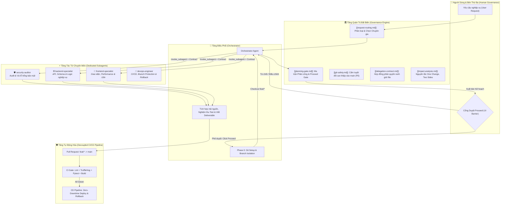

# 📘 Cẩm Nang Vận Hành Hệ Thống Đa Tác Tử Chuẩn Enterprise (Multi-Agent SOP v2.0)

> [!ABSTRACT] TỔNG QUAN HỆ THỐNG
> Tài liệu này chuẩn hóa **Quy trình Vận hành Tiêu chuẩn (SOP)** cho việc điều phối hệ sinh thái tác tử AI trong môi trường **Google Antigravity** theo các tiêu chuẩn kỹ nghệ phần mềm doanh nghiệp hàng đầu: **OWASP LLM Top 10 (2025)**, **NIST AI RMF 1.0** và **GitOps / Decoupled CI/CD**.
> 
> Chuyển đổi toàn diện từ mô hình *"AI can thiệp trực tiếp vào mã nguồn trên main"* sang mô hình *"Hệ thống đa tác tử phân quyền, cô lập nhánh, ràng buộc hợp đồng và có cổng kiểm soát của con người (Human-in-the-Loop Planning Gate)"*.

---

## 🏗️ 1. Sơ Đồ Kiến Trúc Hệ Thống Đa Tầng (Enterprise 4-Tier Architecture)



---

## 📋 2. Quy Trình Vận Hành Tiêu Chuẩn 6 Bước (The 6-Step Enterprise SOP)

### Bước 1: Phân Loại & Điều Hướng (Request Classification)
- Mọi yêu cầu đều được quy tắc `[[request-routing.md]]` phân tích tự động.
- Với các tác vụ phức tạp (kiểm toán, refactor, tính năng đa tầng), tự động trao quyền cho `orchestrator`.

### Bước 2: Cam Kết Lập Tức Tại Lượt Đầu (Turn-1 Constraint)
- Bắt buộc phát thông báo công khai ngay tại lượt trả lời đầu tiên:
  ```markdown
  🤖 **Applying knowledge of `@[specialist-agent]`...**
  📚 **Using skills: `@[skill-1]` + `@[skill-2]`...**
  ```
- Tuyệt đối không chạy chuỗi công cụ âm thầm rồi mới thông báo ở cuối.

### Bước 3: Lập Ma Trận Phân Công & Dừng Tuyệt Đối (Planning Gate Barrier)
- Lập ma trận đầy đủ các Phase (bắt đầu bằng **Phase 0: Workspace & Git Setup**).
- Xuất bản ra Artifact với metadata `RequestFeedback: true`.
- 🛑 **HARD STOP:** AI dừng ngay lập tức, không được tự ý thực thi mã trước khi người dùng bấm **Proceed**.

### Bước 4: Thiết Lập Nhánh & Khởi Tạo Phân Quyền (Phase 0 Setup)
- Ngay sau khi được duyệt, Orchestrator chạy lệnh:
  ```bash
  git branch --show-current
  git checkout -b feat/<task-slug>-$(date +%Y%m%d)
  ```
- **Kích hoạt Subagents kèm Delegation Contract:**
  Mỗi subagent được giao vùng file riêng biệt (Disjoint Sets), không bao giờ để 2 subagents cùng sửa 1 file.

### Bước 5: Thực Thi Phân Quyền, Báo Checkpoint & Chống Silent Loop
- Báo cáo checkpoint rõ ràng tại ranh giới mỗi Phase.
- Áp dụng **Anti-Silent Circuit Breaker**: Không chạy quá 8 tool calls liên tiếp mà không phát báo cáo trung gian.

### Bước 6: Nghiệm Thu Thực Nghiệm, Tạo PR & Kích Hoạt CI Gate
- Kiểm thử toàn diện (`pytest`, `npm test`).
- Kiểm tra `git diff --stat` và `git status -s`.
- Tạo Pull Request để kích hoạt **CI Gate tự động** (Linting, Secret Scan, Regression Tests).

---

## 📊 3. Bảng Đối Chiếu Thực Chiến: 3 Dự Án Điển Hình

| Tiêu Chí So Sánh | ❌ Phiên Cũ (`249a2be1`) | ⚠️ Phiên Chuẩn Cũ (`7ef1749f`) | ⚠️ Dự Án `tinktinkai` | 🏆 Enterprise SOP v2.0 |
| :--- | :--- | :--- | :--- | :--- |
| **Cơ chế Điều Phối** | Đơn khối (Monolithic) | Đa tác tử (Subagents song song) | Đa tầng (Monorepo FE/BE) | Đa tác tử phân quyền + Contract |
| **An Toàn Nhánh Git** | ❌ Sửa trực tiếp trên `main` | ❌ Sửa trực tiếp trên `main` | ⚠️ Có rule nhưng CI deploy thẳng `main` | ✅ **Bắt buộc checkout `feat/*` tại Phase 0** |
| **Phân Quyền File** | Không phân quyền | ❌ 3 subagents cùng mode `inherit` | ⚠️ Dễ lệch schema API | ✅ **Disjoint File Sets via Contract** |
| **Bảo Mật Secrets** | Chưa kiểm soát | Chưa kiểm soát | ❌ Commit file `.env` vào backend | ✅ **Zero-Secret Commit + TruffleHog** |
| **Đường Ống CI/CD** | ❌ Không có | ❌ Không có | ⚠️ Deploy-only (không có test gate) | ✅ **2-Stage: CI Test Gate + CD Rollback** |
| **Đồng Bộ Full-Stack** | Không kiểm tra | Kiểm tra thủ công | ✅ Có tài liệu Impact Analysis | ✅ **Rule `impact-analysis.md` (P1)** |

---

## 🛠️ 4. Hướng Dẫn Kích Hoạt & Đồng Bộ (Quick Start)

Kho lưu trữ `Agent-test` đã được trang bị bộ công cụ tự động hóa đầy đủ:

```bash
cd ~/Vscode/Agent-test

# Xem danh sách lệnh hỗ trợ
make help

# Cài đặt và kích hoạt hệ thống quy tắc v2.0 (Tạo Symlink)
make install

# Kiểm tra tính toàn vẹn của 100% rules và agents
make verify
```
