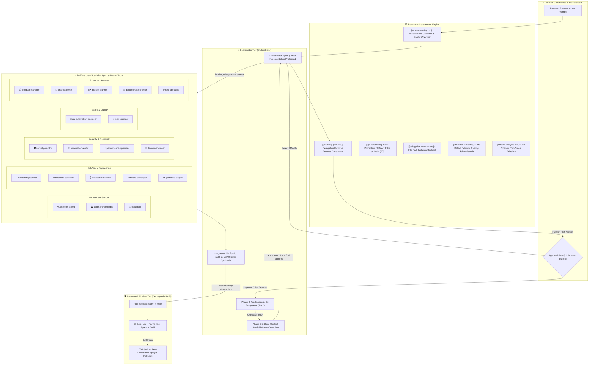

# 📘 Enterprise Multi-Agent Operating Playbook (SOP v2.1)

> [!ABSTRACT] SYSTEM OVERVIEW
> This playbook establishes the **Standard Operating Procedure (SOP)** for orchestrating collaborative AI agent swarms within the **Google Antigravity** runtime. It synthesizes top-tier enterprise software engineering guidelines: **OWASP LLM Top 10 (2025)**, **NIST AI RMF 1.0**, and **GitOps / Decoupled CI/CD Pipelines**.
> 
> It marks a complete paradigm shift from *"ad-hoc autonomous AI agents modifying source code directly on main"* to a *"governed, branch-isolated, contract-bound multi-agent ecosystem with Human-in-the-Loop Planning Gates, verified native subagent tool resolution, and empirical pre-delivery deliverable verification"*.

---

## 🏗️ 1. Multi-Tier Enterprise System Architecture



---

## 📋 2. The 6-Step Enterprise Standard Operating Procedure

### Step 1: Autonomous Request Classification & Router Checklist
* Every user request is classified autonomously per `[[request-routing.md]]`.
* Complex multi-domain requests (audits, refactoring, cross-stack features, multi-step implementations) automatically activate the `orchestrator`.
* **Router Checklist Gate:** The model must mentally complete the 8-item Router Checklist before taking action, confirming agent selection, rule loading, Turn-1 announcements, planning gate needs, and subagent delegation obligations.

### Step 2: Immediate Turn-1 Announcement Constraint (Text-First)
* The AI must publicly announce its active persona and skills in its **very first turn**, prior to or accompanied by its first tool call:
  ```markdown
  🤖 **Applying knowledge of `@[specialist-agent]`...**
  📚 **Using skills: `@[skill-1]` + `@[skill-2]`...**
  ```
* ❌ **Strictly Forbidden:** Running autonomous tool loops silently and announcing active skills retroactively at the end of execution is a major protocol violation.

### Step 3: Delegation Matrix Formulation & Hard Stop Barrier
* Formulate a structured phase breakdown starting with **Phase 0: Workspace & Git Safety Setup** and **Phase 0.5: Base Context Scaffold & Auto-Detection**.
* Publish the execution plan to a markdown artifact with metadata:
  ```json
  "ArtifactMetadata": {
    "RequestFeedback": true,
    "UserFacing": true,
    "Summary": "Enterprise multi-agent delegation plan and Git safety setup."
  }
  ```
* 🛑 **HARD STOP (Immediate Tool Termination):** The AI must immediately halt tool execution upon publishing the artifact and wait for the human user to click the **Proceed** button or confirm explicitly in chat.

### Step 4: Phase 0 Setup, Phase 0.5 Base Context Auto-Scaffold & Subagent Delegation
* Immediately upon approval, the Orchestrator runs:
  ```bash
  git branch --show-current
  git checkout -b feat/<task-slug>-$(date +%Y%m%d)
  ```
* **Phase 0.5 Context Scaffold Execution (When Applicable):**
  - Check if `.agents/knowledge/project-overview.md` exists in the target repository.
  - If missing or uninitialized, execute `./scripts/scaffold.sh <target-dir>` (or `make scaffold-project TARGET=<target-dir>`).
  - This automatically discovers ecosystem manifests (Node.js `package.json`, Python `pyproject.toml`/`requirements.txt`, Rust `Cargo.toml`, Go `go.mod`) and bootstraps standardized `.agents/knowledge/` and `.agents/workflows/` so downstream specialist agents have baseline architectural context before Phase 1 discovery begins.
* **Enforce True Delegation & Phase Transparency (P0 Mandate):**
  Every implementation phase assigned to a specialist must dispatch a dedicated subagent (`invoke_subagent`) or swarm worker (`swarm add`).
* 🛑 **Direct Implementation Prohibition:** The coordinator is **strictly prohibited from directly writing application code** during implementation phases.
* 🛑 **Anti-Pretense Mandate:** Merely printing specialist announcement banners in chat while running tools monolithically in the coordinator thread (*Pretense Violation*) is strictly forbidden.
* Every subagent receives a formal **Delegation Contract** enforcing:
  - Exclusive, disjoint file boundaries (`Allowed File Paths`).
  - Prohibited shared paths and main branch protections.
  - `Model` tier selection (`Model: "flash"` default for discovery/routine/QA; `inherit` / `pro` for deep architecture, complex debugging, and synthesis).
  - Coordinator `schedule` one-shot watchdog (`DurationSeconds: 600`, `TimerCondition: "<subagentId>"` or `"any"`).
  - Required empirical verification commands (`120s` portable hard timeout, `MAX_RETRIES=3`).
  - Zero overlapping file ownership across concurrent agents.

### Step 5: Checkpoint Transparency, 4-Tool Circuit Breaker, Watchdogs & Scratch Space Isolation
* **Phase Checkpoint Announcements:** Every phase transition emits a public checkpoint banner accompanied in the same or next step by the actual subagent dispatch tool call.
* **Anti-Silent Circuit Breaker (≤4 Tools):** An agent must **never execute more than 4 consecutive tool calls** without emitting visible interim progress text to the user (mechanically enforced by `hooks/circuit-breaker.mjs`).
* **Background Task Communication:** Subagents launching a background `run_command` MUST emit an interim `send_message` update to the parent BEFORE ending their turn to wait (monitoring via `NotificationTimeoutSeconds` / `schedule`), because canceled tasks emit `MESSAGE_PRIORITY_LOW` and will not wake an idle subagent.
* **Clean Wakeups:** On watchdog timeout or user `"Continue"`, coordinators communicate via `send_message` / `manage_subagents` rather than inspecting raw subagent `transcript.jsonl` via shell.
* **Scratch Space Hygiene & Isolation:** All temporary generator scripts, intermediate assets, and diagnostic fixtures must strictly reside in `<Artifact Directory Path>/scratch/` or `/tmp/`. Never generate scratch code or dump intermediate build artifacts in the repository root.

### Step 6: Zero-Defect Delivery, Pre-Delivery Verification & Automated CI Gate
* **Mandatory Pre-Delivery Deliverable Verification:** Every generated deliverable (`.docx`, `.xlsx`, `.pdf`, `.md`, `.txt`, `.json`) must pass:
  ```bash
  ./scripts/verify-deliverable.sh path/to/deliverable \
    || ~/.gemini/config/plugins/ag-kit/scripts/verify-deliverable.sh path/to/deliverable
  ```
  Verification must prove ZIP container integrity, XML schema validity (specifically preventing ECMA-376 OpenXML schema defects), and OS reader parseability (`textutil -info` on macOS) before final presentation.
* **Execution & Resilience Metrics Report:** Every Phase 4 completion summary and session audit report must include the **Execution & Resilience Metrics** table (covering `Agent / Subagent (ID)`, `Model Tier`, `Wall Time`, `Timeouts Configured / Triggered`, `Retry Attempts (used/max)`, `Circuit-Breaker Denials`, and `Completion Signal`).
* Run all regression test suites (`make verify`, unit tests, linting) under `120s` timeouts and `MAX_RETRIES=3`.
* Review `git status -s` and `git diff --stat` to ensure zero scratch files leaked into the git index.
* Open a Pull Request to trigger the automated **2-Stage CI Gate** (linting, secret scan, build validation).

---

## ⚙️ 3. The Native Subagent Tool Mapping Architecture (v2.1)

### The Mechanical Root Cause Discovered
During forensic audits of failed and simulated sessions, an underlying mechanical breakdown was uncovered:
* Legacy agent definitions declared Claude Code tool grants (`Read`, `Grep`, `Glob`, `Bash`, `Edit`, `Write`).
* When Antigravity's runtime attempted to construct subagents using those definitions, it failed with:
  ```text
  failed to construct executor: failed to resolve components: unknown component: tool "Read" not found in registry
  ```
* Coordinators, anticipating or encountering this crash, retreated into **Simulated Execution (Pretense Violations)**—printing markdown headers while running monolithic single-threaded tools.

### The Canonical Antigravity Tool Specification
All 20 enterprise agents in [`agents/`](file:///Users/iminluv/Vscode/Agent-test/agents) have been remapped to the native Antigravity schema:

```yaml
---
name: specialist-agent
description: Comprehensive specialist role description
tools:
  - read_file      # Replaces Read, Glob, Grep
  - edit_file      # Replaces Edit, MultiEdit
  - write_file     # Replaces Write
  - run_command    # Replaces Bash
  - manage_task    # Background process management
  - search_web     # Web research
subagent: true     # Declares subagent capability
mainAgent: false   # Specialist subagent flag
model: inherit
version: 2.1.0
---
```

### Static vs. Dynamic Subagent Architecture
* **Static Plugin Agents:** Stored in `~/.gemini/config/plugins/ag-kit/agents/` and ingested when an Antigravity IDE session or conversation initializes.
* **Dynamic Subagents (`define_subagent`):** Created programmatically in-session for runtime-specific workflows. Grants `EnableWriteTools: true` and inherits native capabilities immediately without requiring an IDE restart.

---

## 🪝 4. Runtime Hooks, Execution Resilience & Model Tiering

### 4.1 `PreToolUse` Hooks (`hooks.json` & `hooks/`)
The repository defines two mechanical `PreToolUse` enforcement hooks in [`hooks.json`](file:///Users/iminluv/Vscode/Agent-test/hooks.json):

| Hook Name | Matcher | Script | Timeout | Responsibility |
| :--- | :--- | :--- | :--- | :--- |
| **`ag-kit-safety-gate`** | `run_command` | `node ./hooks/validate-tool-call.mjs` | `10s` | Blocks catastrophic root deletion (`rm -rf /`), filesystem formatting (`mkfs`, `format`), and raw disk overwrites (`dd ... of=/dev/*`); fails open on malformed stdin. |
| **`ag-kit-circuit-breaker`** | `*` | `node ./hooks/circuit-breaker.mjs` | `5s` | Tails the active transcript and blocks the 5th consecutive silent tool call when no user-facing model progress text has been emitted (strict ceiling: `4`). |

### 4.2 Timeouts (`120s`), Bounded Retries (`MAX_RETRIES=3`) & Bash 3.2 Safety
> [!IMPORTANT] COMMAND TIMEOUTS ON MACOS & TOOL PARAMETERS
> macOS does not ship GNU `timeout` by default. Wrap test/verification commands with `perl -e 'alarm shift; exec @ARGV' 120 <cmd>`, Python `subprocess.run(..., timeout=120)`, or bounded wait loops. **Never rely on `WaitMsBeforeAsync` as a timeout** (it only backgrounds an uncompleted command) or **`NotificationTimeoutSeconds`** (it only triggers a reminder ping) — neither terminates a hung process.

* **Retry Ceiling (`MAX_RETRIES=3`):** Automated retries are capped at 3 attempts with explicit stop-and-escalate on exhaustion; infinite/silent retry loops are forbidden.
* **Bash Test Script Hygiene:**
  1. **Ban bare `wait`:** When a script starts background servers or daemons, always `wait "$CLIENT_PID"` on explicit client/worker PIDs.
  2. **Mandatory cleanup traps:** Register `trap 'kill -TERM "${SERVER_PID:-}" 2>/dev/null || true' EXIT INT TERM` on background server/daemon harnesses.
  3. **Bash 3.2 `set -u` array safety:** Guard empty arrays with `if [ ${#ARR[@]} -gt 0 ]` before expanding `"${ARR[@]}"`.

### 4.3 Subagent Watchdogs, Parent Communication & `Model` Tiering
* **Subagent `Model` Tiering:** Default to `Model: "flash"` on `invoke_subagent` for discovery (`explorer-agent`), routine implementation, and QA/test scripting; reserve `inherit` / `pro` for deep architecture, complex debugging, or multi-domain synthesis.
* **Coordinator `schedule` Watchdog:** Every long-running `invoke_subagent` call MUST attach a `schedule` one-shot watchdog (`DurationSeconds: 600`, `TimerCondition: "<subagentId>"` or `"any"`).
* **Interim `send_message` Before Background Wait:** Any subagent launching a background `run_command` MUST send an interim `send_message` status update to the parent agent BEFORE ending its turn to wait (monitoring via `NotificationTimeoutSeconds` / `schedule`), because canceled background tasks emit `MESSAGE_PRIORITY_LOW` and will NOT wake an idle subagent.
* **Clean Wakeups:** When waking on watchdog timeout or user `"Continue"`, coordinators MUST communicate via `send_message` / `manage_subagents` rather than inspecting raw subagent `transcript.jsonl` via shell.

### 4.4 Execution & Resilience Metrics Table (Mandatory in Phase 4 & Audit Reports)

| Agent / Subagent (ID) | Model Tier | Wall Time | Timeouts Configured / Triggered | Retry Attempts (used/max) | Circuit-Breaker Denials | Completion Signal |
| :--- | :--- | :--- | :--- | :--- | :--- | :--- |
| `<agent> (<id>)` | `flash` / `inherit` / `pro` | `<Ns>` | `120s cmd, 600s watchdog / 0` | `0/3` | `0` | `send_message` / `watchdog` / `manual resume` |

---

## 📊 5. Empirical Comparative Analysis: Auditing Real-World Sessions

The effectiveness of Enterprise SOP v2.1 is proven through forensic audits of real-world sessions conducted across different project domains:

| Dimension | ❌ Session `9e05c5aa` (Lab 2 Embedded) | ❌ Session `d7684248` (Almadungduong 360°) | ⚠️ Session `8eb5832c` (Governance Hardening) | 🏆 Enterprise SOP v2.1 Benchmark |
| :--- | :--- | :--- | :--- | :--- |
| **Task Scope** | STM32 Lab report in `.docx` | 360-degree audit across 8 domains | Rule hardening & Big-data review | Multi-domain feature / audit |
| **Planning Gate** | 🔴 **Bypassed (0/10)**<br>Zero plan artifacts created | 🟢 **Compliant (10/10)**<br>Plan artifact + Proceed barrier | 🟢 **Compliant (10/10)**<br>Halted for user `"ok"` | ✅ **Plan Artifact + Proceed Gate Barrier** |
| **Delegation Model** | Monolithic single thread | 🔴 **Pretense Violation (0/25)**<br>10 banners, 0 subagents | 🟢 **Authorized Scope**<br>Coordinator maintenance | ✅ **True Subagents via `invoke_subagent`** |
| **Circuit Breaker** | 🔴 **15 & 19 silent calls** | 🔴 **53 consecutive silent calls** | 🔴 **30 silent calls** during audit | ✅ **Strict ≤4 Consecutive Tools Ceiling** |
| **Deliverable QA** | 🔴 **Corrupted docx delivered**<br>Bare `<w:p><w:fldChar/></w:p>` | 🟢 Non-destructive read audit | 🟢 `make verify` passed (100%) | ✅ **Zero-Defect `./scripts/verify-deliverable.sh`** |
| **Workspace Cleanliness**| 🔴 **Polluted root**<br>81 KB Python scripts in root | 🟢 Clean repository tree | 🟢 Clean branch `feat/*` | ✅ **Strict `<Artifact>/scratch/` Isolation** |
| **Composite Score**| **51 / 100 (D+)** | **42 / 100 (D)** | **85.7 / 100 (B+)** | **100% Fully Compliant (A+)** |

---

## 🛠️ 6. Operational Tooling & Scripts Reference

The `Agent-test` repository provides turnkey management and validation tooling:

```bash
cd ~/Vscode/Agent-test

# 1. View operational commands
make help

# 2. Synchronize all 11 rules and 20 agents to Antigravity configuration
make install            # Default symlink mode (real-time propagation)
make install-copy       # Static copy mode

# 3. Comprehensive integrity verification & YAML frontmatter static analysis
make verify             # Validates rules, agents, and native tool declarations
./scripts/verify.sh --repo   # Verify repository files only
./scripts/verify.sh --all    # Verify repository + installed configuration

# 4. Mandatory Pre-Delivery Deliverable Verification (local or global fallback)
./scripts/verify-deliverable.sh path/to/document.docx
~/.gemini/config/plugins/ag-kit/scripts/verify-deliverable.sh path/to/spreadsheet.xlsx
./scripts/verify-deliverable.sh path/to/report.pdf

# 5. Bootstrap standardized .agents/ structure into a target project
make scaffold-project TARGET=/path/to/target-project
```

---

## 📜 7. Governance Checklist (The Zero-Defect Standard)

Before delivering any work, every agent must verify:
- [ ] **Turn-1 Text Emitted:** Stated `@agent` and `@skills` before tool calls.
- [ ] **Planning Gate Respected:** User approved plan artifact before source edits.
- [ ] **Phase 0 Branch Active:** Never edit on `main` or `master`.
- [ ] **Phase 0.5 Context Verified:** Verified `.agents/knowledge/project-overview.md` and bootstrapped context via `scaffold.sh` if uninitialized.
- [ ] **True Subagents & Model Tiering:** Dispatched real subagents with exclusive contracts, `Model` tiering (`flash` default for discovery/routine/QA), and `schedule` watchdogs (`DurationSeconds: 600`).
- [ ] **Circuit Breaker & Messaging Honored:** Never exceeded 4 silent tool calls without user updates; sent interim `send_message` before background waits.
- [ ] **Timeouts, Retries & Bash 3.2 Hygiene:** Enforced `120s` portable timeouts, `MAX_RETRIES=3`, cleanup `trap`, explicit `wait "$PID"`, and `if [ ${#ARR[@]} -gt 0 ]`.
- [ ] **Workspace Unpolluted:** All generators and temporary fixtures placed in `scratch/`.
- [ ] **Pre-Delivery Verification & Metrics:** `verify-deliverable.sh` reported 0 errors and the **Execution & Resilience Metrics** table is included.
