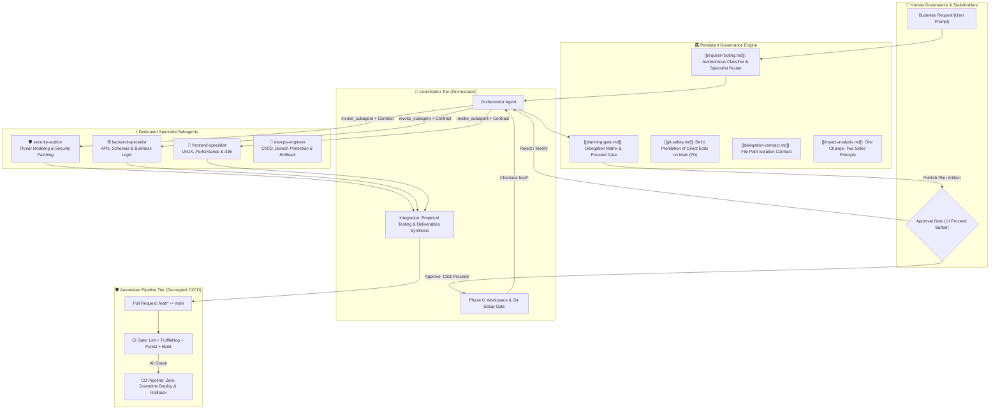

# 📘 Enterprise Multi-Agent Operating Playbook (SOP v2.0)

> [!ABSTRACT] SYSTEM OVERVIEW
> This playbook establishes the **Standard Operating Procedure (SOP)** for orchestrating collaborative AI agent swarms within the **Google Antigravity** runtime. It synthesizes top-tier enterprise software engineering guidelines: **OWASP LLM Top 10 (2025)**, **NIST AI RMF 1.0**, and **GitOps / Decoupled CI/CD Pipelines**.
> 
> It marks a complete paradigm shift from *"ad-hoc autonomous AI agents modifying source code directly on main"* to a *"governed, branch-isolated, contract-bound multi-agent ecosystem with Human-in-the-Loop Planning Gates"*.

---

## 🏗️ 1. Multi-Tier Enterprise System Architecture



---

## 📋 2. The 6-Step Enterprise Standard Operating Procedure

### Step 1: Autonomous Request Classification & Routing
- Every user request is classified autonomously per `[[request-routing.md]]`.
- Complex multi-domain requests (audits, refactoring, cross-stack features) route immediately to the `orchestrator`.

### Step 2: Immediate Turn-1 Announcement Constraint
- The AI must publicly announce its active persona and skills in its **very first turn**:
  ```markdown
  🤖 **Applying knowledge of `@[specialist-agent]`...**
  📚 **Using skills: `@[skill-1]` + `@[skill-2]`...**
  ```
- Executing silent tool loops before announcing persona is strictly forbidden.

### Step 3: Delegation Matrix Formulation & Hard Stop Barrier
- Formulate a comprehensive phase breakdown starting with **Phase 0: Workspace & Git Safety Setup**.
- Publish the plan to an artifact with metadata `"RequestFeedback": true`.
- 🛑 **HARD STOP:** The AI halts all tool execution and waits for the user to click **Proceed**.

### Step 4: Phase 0 Setup & Contract-Bound Delegation
- Immediately upon approval, the Orchestrator runs:
  ```bash
  git branch --show-current
  git checkout -b feat/<task-slug>-$(date +%Y%m%d)
  ```
- **Dispatch Subagents with Delegation Contracts (P0 Mandatory):**
  Every implementation phase MUST dispatch a dedicated subagent (`invoke_subagent`) or swarm worker (`swarm add`). The coordinator is **strictly prohibited from directly writing application code**. Every subagent receives an explicit contract allocating exclusive, disjoint file boundaries (`Allowed File Paths`). Two concurrent subagents must never write to the same file.

### Step 5: Checkpoint Transparency & Anti-Silent Circuit Breaker
- Announce public checkpoint banners accompanied by the actual dispatch tool call (`invoke_subagent` or `swarm add`).
- Enforce the circuit breaker: Never exceed 4 tool calls consecutively without visible interim progress text to the user.
- Enforce scratch file isolation: All temporary generator scripts, intermediate assets, and diagnostic fixtures must reside in `<Artifact Directory Path>/scratch/` or `/tmp/`, never in the repository root.

### Step 6: Empirical Acceptance, Deliverable Verification & Automated CI Gate
- Mandatory Pre-Delivery Verification: Validate all generated deliverables (`.docx`, `.xlsx`, `.pdf`, `.md`, `.txt`) with `./scripts/verify-deliverable.sh <path>` before presenting to users.
- Run all regression test suites (`pytest`, `npm test`, `make verify`).
- Review `git status -s` and `git diff --stat` to verify no scratch files leaked into the working tree.
- Open a Pull Request to trigger the automated **2-Stage CI Gate** (linting, secret scan, build validation).

---

## 📊 3. Empirical Comparative Analysis: 3 Real-World Projects

| Dimension | ❌ Legacy Session (`249a2be1`) | ⚠️ Unhardened Run (`7ef1749f`) | ⚠️ Production App (`tinktinkai`) | 🏆 Enterprise SOP v2.0 |
| :--- | :--- | :--- | :--- | :--- |
| **Coordination Model** | Monolithic (single thread) | Multi-Agent (concurrent subagents) | Cross-Stack Monorepo | Multi-Agent with Delegation Contracts |
| **Git Branch Safety** | ❌ Modified directly on `main` | ❌ Committed directly on `main` | ⚠️ Guidelines exist, but CI deploys `main` | ✅ **Mandatory checkout `feat/*` in Phase 0** |
| **File Path Isolation** | No isolation | ❌ 3 subagents in shared `inherit` | ⚠️ Risk of schema divergence | ✅ **Disjoint File Sets via Contracts** |
| **Secret Governance** | Unchecked | Unchecked | ❌ `.env` file committed to backend | ✅ **Zero-Secret Commit + TruffleHog CI Gate** |
| **CI/CD Pipeline** | ❌ None | ❌ None | ⚠️ Deploy-only (no automated test gate) | ✅ **2-Stage: CI Test Gate + CD Rollback** |
| **Full-Stack Sync** | Unchecked | Manual review | ✅ Documented Impact Analysis | ✅ **Enforced `impact-analysis.md` (P1)** |

---

## 🛠️ 4. Quick Start & Tooling Reference

The `Agent-test` repository provides turnkey management tools:

```bash
cd ~/Vscode/Agent-test

# View available operational commands
make help

# Bootstrap and synchronize v2.0 governance rules and agents (Symlink)
make install

# Verify 100% integrity across all rules and specialist agents
make verify

# Empirically verify any generated deliverable before user presentation
./scripts/verify-deliverable.sh path/to/document.docx
```
