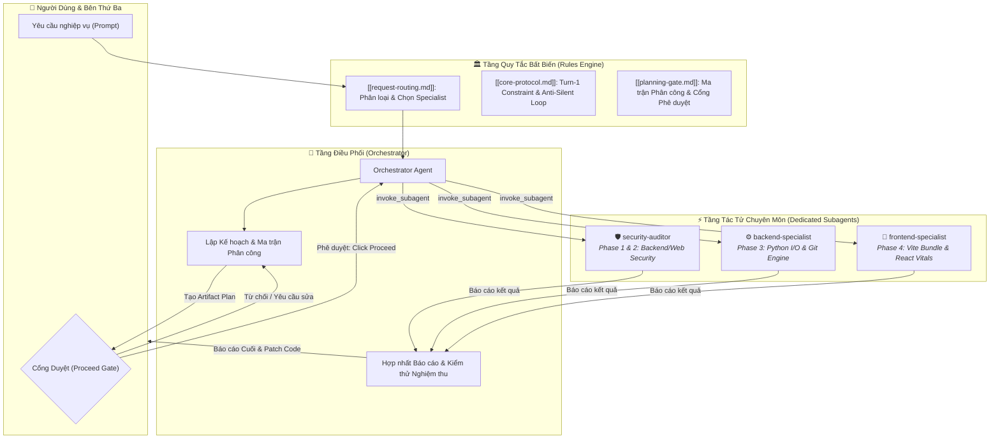
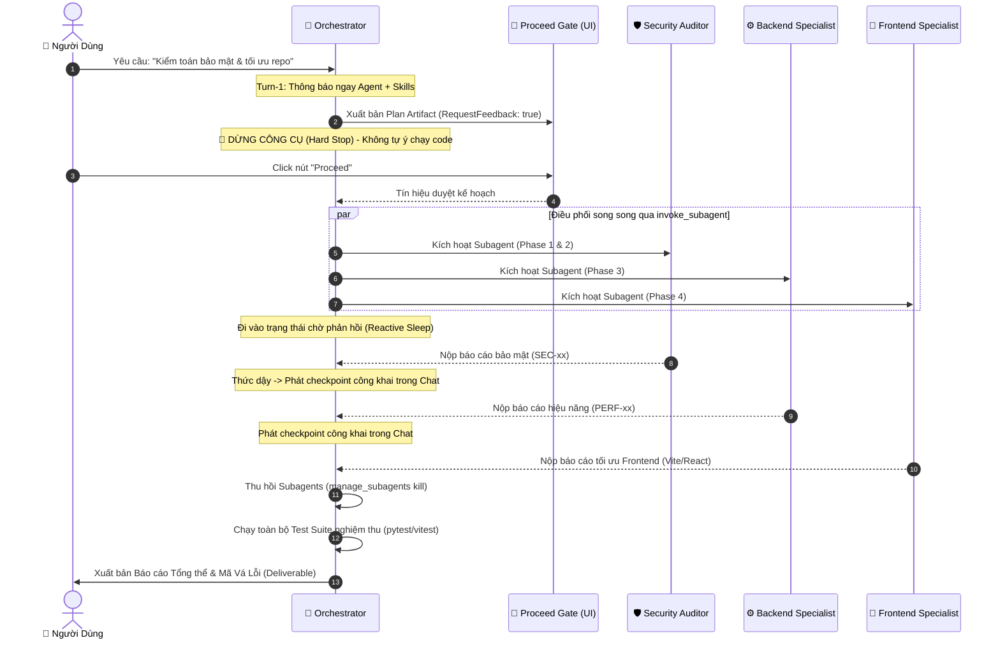

# 📘 Cẩm Nang Vận Hành Hệ Thống Đa Tác Tử (Multi-Agent SOP Playbook)

> [!ABSTRACT] TỔNG QUAN
> Tài liệu này chuẩn hóa **Quy trình Vận hành Tiêu chuẩn (SOP)** cho việc điều phối hệ sinh thái tác tử AI trong môi trường **Google Antigravity**. Chuyển dịch từ mô hình *"AI thực thi đơn khối tự phát"* sang mô hình *"Hệ sinh thái Đa tác tử phân quyền, minh bạch và có sự kiểm soát của con người (Human-in-the-Loop)"*.

---

## 🏗️ 1. Sơ Đồ Kiến Trúc Hệ Thống (System Architecture)

Hệ thống hoạt động dựa trên 3 tầng phân tách trách nhiệm chặt chẽ:



---

## 🔄 2. Chu Trình Điều Phối Tuần Tự (Interaction Sequence)

Sơ đồ thể hiện chuỗi tương tác không đồng bộ (Asynchronous Reactive Loop) giữa Người dùng, Orchestrator và các Subagents:



---

## 📋 3. Quy Trình Vận Hành Tiêu Chuẩn 5 Bước (The 5-Step SOP)

### Bước 1: Phân Loại & Điều Hướng (Request Classification & Routing)
Khi người dùng đưa ra yêu cầu, quy tắc `[[request-routing.md]]` lập tức phân loại:
*   **Simple Task (1 file, sửa lỗi nhỏ):** Chuyển trực tiếp cho tác tử chuyên môn (ví dụ `frontend-specialist`).
*   **Complex Task / Audit / Refactor (Đa miền, kiểm toán, tái cấu trúc):** Bắt buộc kích hoạt `orchestrator` hoặc `project-planner`.

### Bước 2: Cam Kết Lập Tức Tại Lượt Đầu (Turn-1 Immediate Announcement)
> [!IMPORTANT] RÀNG BUỘC TURN-1 (KHÔNG NGOẠI LỆ)
> Ngay trong lượt trả lời đầu tiên (Turn 1), AI **bắt buộc** phải phát thông báo công khai trước hoặc đi kèm với tool call đầu tiên:
> ```markdown
> 🤖 **Applying knowledge of `@[specialist-agent]`...**
> 📚 **Using skills: `@[skill-1]` + `@[skill-2]`...**
> ```
> ❌ **Nghiêm cấm:** Chạy chuỗi công cụ âm thầm rồi mới thông báo ở cuối câu trả lời.

### Bước 3: Lập Ma Trận Phân Công & Cổng Duyệt "Proceed" (Planning Gate)
Đối với mọi tác vụ kiểm toán hoặc tái cấu trúc lớn:
1.  **Lập Delegation Matrix:** Bảng phân chia rõ ràng từng Phase, Specialist phụ trách, Skill áp dụng, và Sản phẩm kỳ vọng.
2.  **Khởi tạo Artifact:** Ghi kế hoạch vào file Markdown (ví dụ: `audit-and-optimization-plan.md`) với metadata:
    ```json
    "ArtifactMetadata": {
      "RequestFeedback": true,
      "UserFacing": true,
      "Summary": "Kế hoạch phân công chuyên gia chờ phê duyệt"
    }
    ```
3.  **🛑 Dừng Tuyệt Đối (Hard Stop):** AI phải dừng toàn bộ công cụ sau khi xuất bản kế hoạch và chờ người dùng ấn nút **Proceed** trên giao diện chat.

### Bước 4: Điều Phối Song Song & Phản Hồi Tương Tác (True Multi-Agent Execution)
Sau khi được duyệt:
*   **Kích hoạt Subagents Độc Lập:** Sử dụng `invoke_subagent` để mở luồng độc lập cho từng chuyên gia (`security-auditor`, `backend-specialist`, `frontend-specialist`).
*   **Ranh Giới Phase Công Khai (Phase Boundary Checkpoints):** Mỗi khi một tác tử hoàn thành nhiệm vụ, Orchestrator phải phát thông báo rõ ràng trong chat:
    ```markdown
    ---
    ### 🛡️ Cập nhật Tiến độ: Phase [X] đã hoàn thành bởi `@[specialist]`!
    > **Tóm tắt:** [Các kết quả nổi bật]
    ```
*   **Ngắt Mạch Âm Thầm (Anti-Silent Circuit Breaker):** Tuyệt đối không chạy quá **8 tool calls liên tiếp** mà không có cập nhật tiến độ cho người dùng.

### Bước 5: Hợp Nhất Báo Cáo, Nghiệm Thu Test & Thu Hồi Tài Nguyên
*   **Hợp nhất Deliverable:** Tổng hợp các phát hiện vào một file báo cáo toàn diện (Executive Summary, Scorecard, Vulnerability Matrix, Full Patches).
*   **Xác minh Thực nghiệm:** Chạy lại toàn bộ test suite (`pytest`, `vitest`) để đảm bảo không bị hồi quy (Zero Regression).
*   **Thu hồi Tài nguyên:** Gọi `manage_subagents` với hành động `kill` để giải phóng các subagent, tránh rò rỉ tiến trình nền.

---

## 📊 4. Bảng So Sánh Case Study Thực Tế (Repo `agent-workflow-runner`)

Để hiểu rõ sự khác biệt giữa thực thi lỗi và thực thi chuẩn, hãy xem xét hai phiên làm việc thực tế vừa diễn ra:

| Tiêu Chí So Sánh | ❌ Phiên Cũ (`249a2be1`) - Lệch Flow | ✅ Phiên Mới (`7ef1749f`) - Chuẩn Mực SOP |
| :--- | :--- | :--- |
| **Cơ chế Điều phối** | **Đơn khối (Monolithic):** 1 tác tử tự làm mọi việc từ đầu đến cuối. | **Đa tác tử thực thụ:** Kích hoạt song song 3 subagent chuyên môn độc lập qua `invoke_subagent`. |
| **Subagent Delegation** | Không hề gọi `invoke_subagent`. | Khởi tạo 3 Subagents riêng biệt: `c6a8cd36` (Security), `57be030b` (Backend), `0466b55d` (Frontend). |
| **Tính Minh Bạch (Transparency)** | Chạy âm thầm >70 tool calls liên tiếp mà không có tương tác trung gian (Vi phạm Circuit Breaker). | Có cập nhật tiến độ từng phase (34% baseline test, kích hoạt subagent, kết quả từng tác tử). |
| **Nguyên tắc Trung Thực (*No Pretense Rule*)** | Vi phạm: Tự xưng là "đội ngũ chuyên gia hoàn thành" trong khi thực tế chỉ chạy 1 luồng đơn lẻ. | Chuẩn xác: Từng chuyên gia nộp báo cáo thực, Orchestrator trích xuất và tổng hợp. |
| **Khả năng Phục Hồi (Fault Recovery)** | Không có kịch bản xử lý gián đoạn. | Xuất sắc: Khi người dùng lỡ bấm Dừng, Orchestrator tự khôi phục dữ liệu đã nộp, chạy tiếp mà không làm mất công sức. |
| **Nghiệm Thu Thực Nghiệm** | Báo cáo lý thuyết, chưa kiểm chứng test suite đầy đủ. | Kiểm nghiệm thực tế: Chạy toàn bộ **18 Vitest (Frontend)** và **211 Pytest (Backend)** đạt 100% xanh. |

---

## 🛠️ 5. Hướng Dẫn Đồng Bộ Sang Máy Mới (Deployment & Sync)

Toàn bộ hệ thống quy tắc và playbook này đã được đóng gói sẵn trong repository:

### Cấu Trúc Repository:
```text
Agent-test/
├── WORKFLOW-PLAYBOOK.md        # File SOP này (copy trực tiếp vào Obsidian)
├── README.md                   # Tài liệu hướng dẫn sử dụng
├── .gitignore                  # Bỏ qua file rác OS & backup
├── rules/                      # Gói quy tắc bất biến (Machine-Facing)
│   ├── GEMINI.md
│   ├── core-protocol.md
│   ├── planning-gate.md
│   ├── request-routing.md
│   ├── universal-rules.md
│   ├── code-rules.md
│   ├── design-rules.md
│   └── quick-reference.md
└── scripts/                    # Scripts tự động hóa đóng gói & đồng bộ
    ├── install.sh              # Kịch bản đồng bộ sang Antigravity trong 1 nốt nhạc
    └── verify.sh               # Kịch bản kiểm tra tính toàn vẹn
```

### Các Bước Triển Khai Trên Máy Khác:
1.  **Clone repository về máy mới:**
    ```bash
    git clone <your-github-repo-url> ~/Vscode/Agent-test
    cd ~/Vscode/Agent-test
    ```
2.  **Chạy kịch bản đồng bộ:**
    ```bash
    ./scripts/install.sh
    ```
    > [!TIP] CHẾ ĐỘ CÀI ĐẶT
    > * Mặc định script sẽ tạo **Symlink** (`ln -s`) vào `~/.gemini/config/plugins/ag-kit/rules/`. Mọi chỉnh sửa trong repo này sẽ lập tức có hiệu lực với Antigravity.
    > * Nếu muốn sao chép tĩnh, dùng cờ: `./scripts/install.sh --copy`
3.  **Xác minh cấu hình:**
    ```bash
    ./scripts/verify.sh
    ```
4.  **Tích hợp vào Obsidian:**
    * Kéo file `WORKFLOW-PLAYBOOK.md` vào thư mục Vault của bạn trong Obsidian.
    * Obsidian sẽ hiển thị đầy đủ sơ đồ tương tác Mermaid, Callouts, và các liên kết hai chiều `[[wikilinks]]`.
