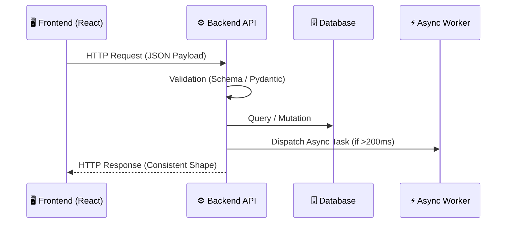

# 🏗️ Kiến Trúc Dự Án & Bản Đồ Tương Tác (Project Architecture)

> Tài liệu tri thức nền tảng giúp AI Agents hiểu rõ ranh giới các tầng và luồng dữ liệu mà không cần đoán mò.

---

## 1. Tổng Quan Hệ Thống

- **Mục tiêu dự án:** [Tóm tắt 1-2 câu về giải pháp]
- **Mô hình kiến trúc:** Layered Architecture / Microservices / Monorepo
- **Ngôn ngữ & Framework:**
  - Backend: [e.g. Python / FastAPI / Node.js]
  - Frontend: [e.g. React / TypeScript / Tailwind]
  - Database: [e.g. PostgreSQL / Redis]

---

## 2. Luồng Dữ Liệu Khép Kín (Data Flow)

---

## 3. Ranh Giới Thư Mục (Directory Boundaries)

- `src/` hoặc `backend/`: Mã nguồn máy chủ và logic nghiệp vụ.
- `frontend/` hoặc `web/`: Giao diện người dùng và trạng thái client.
- `tests/`: Bộ kiểm thử tự động (Unit, Integration, E2E).
