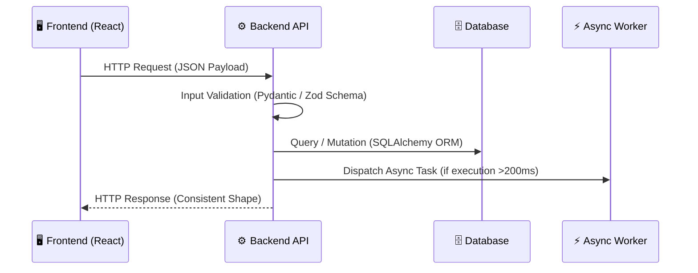

# 🏗️ Project Architecture & Data Flow Specification

> Foundational architectural documentation enabling AI Agents to understand system boundaries, interfaces, and end-to-end data flows without ambiguity.

---

## 1. System Overview

- **Project Goal:** [Concise 1-2 sentence description of the system's purpose]
- **Architecture Model:** Layered Architecture / Microservices / Event-Driven / Monorepo
- **Tech Stack:**
  - Backend: [e.g., Python / FastAPI / Node.js]
  - Frontend: [e.g., React / TypeScript / Vite / Tailwind CSS]
  - Database & Cache: [e.g., PostgreSQL / Redis]
  - Background Workers: [e.g., Celery / Temporal / BullMQ]

---

## 2. End-to-End Data Flow

---

## 3. Directory Boundaries & Ownership

- `src/` or `backend/`: Server-side business logic, routers, models, and services.
- `frontend/` or `web/`: Client-side UI components, hooks, state, and assets.
- `tests/`: Automated test suites (Unit, Integration, and E2E regression tests).
- `.agents/knowledge/`: Domain-specific documentation, workflow traces, and API contracts.
